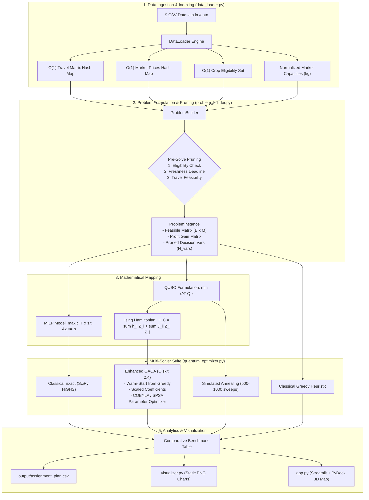
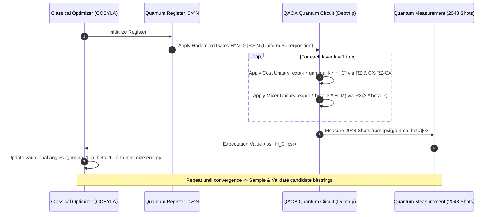
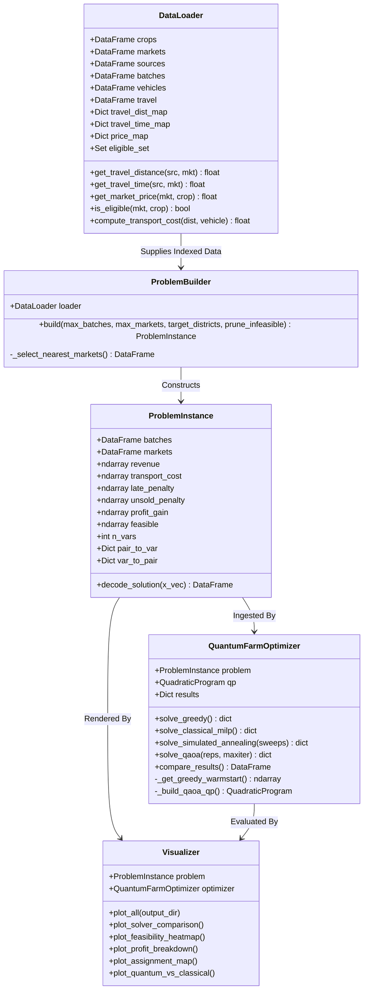

# AgriQuantum: Quantum Optimization-Based Agricultural Supply Chain System
## System Architecture, Mathematical Specification & Technical Reference Manual

> **Document Purpose**: This document is an exhaustive, machine- and human-readable specification of the **AgriQuantum** project. Any AI agent, LLM, or software engineer reading this document will understand the exact domain context, dataset schemas, mathematical formulations (QUBO/Ising), quantum circuit design (QAOA), classical baselines, software modules, and execution pipelines.

---

## 1. Executive Summary & Intent

### 1.1 Problem Statement
In Tamil Nadu, agricultural produce (e.g., tomatoes, onions, bananas, rice) is harvested daily across rural collection centres and must be dispatched to municipal wholesale markets (**Regulated Markets** and **Uzhavar Santhais**). Perishable crops degrade rapidly, daily market prices fluctuate across districts, and road transport incurs fuel and transit costs.

Logistics planners must solve the daily **Farm-to-Market Dispatch Problem**:
1. Which batch of produce goes to which market?
2. Which truck handles the transit?
3. Does the shipment arrive before the crop's perishable shelf-life deadline?
4. Does the shipment violate market daily throughput capacity or crop eligibility rules?

### 1.2 Mathematical Nature
This is an **NP-Hard Mixed-Integer Quadratic / Binary Combinatorial Optimization Problem**. Classical exact solvers (e.g., Branch-and-Cut) scale exponentially in worst-case computational complexity as the number of batches $B$ and markets $M$ grows ($O(M^B)$ search space).

### 1.3 Project Objective
This capstone proves that the agricultural dispatch problem can be:
1. Formulated as a **Quadratic Unconstrained Binary Optimization (QUBO)** problem.
2. Mapped onto a physical **Ising Spin Hamiltonian** ($H_C = \sum h_i Z_i + \sum J_{ij} Z_i Z_j$).
3. Solved using the **Quantum Approximate Optimization Algorithm (QAOA)** with parameter optimization on a quantum circuit (using Qiskit 2.4).
4. Rigorously benchmarked against three classical paradigms:
   - **Classical Exact MILP** (HiGHS Branch-and-Cut via SciPy)
   - **Simulated Annealing** (stochastic thermal exploration over QUBO)
   - **Greedy Heuristic** (real-time $O(N \log N)$ priority dispatch)

---

## 2. End-to-End System Pipeline



---

## 3. Dataset Schemas & Relationships

The system ingests 9 interconnected CSV files stored in `data/`:

```mermaid
erDiagram
    CROP_MASTER ||--o{ DAILY_BATCHES : "harvested_as"
    CROP_MASTER ||--o{ MARKET_CROP_ELIGIBILITY : "regulated_by"
    CROP_MASTER ||--o{ UZHAVAR_DAILY_PRICES : "priced_as"
    SUPPLY_LOCATIONS ||--o{ DAILY_BATCHES : "originated_at"
    SUPPLY_LOCATIONS ||--o{ TRAVEL_MATRIX : "origin_point"
    MARKET_MASTER ||--o{ TRAVEL_MATRIX : "destination_point"
    MARKET_MASTER ||--o{ MARKET_CROP_ELIGIBILITY : "enforces"
    MARKET_MASTER ||--o{ UZHAVAR_DAILY_PRICES : "quotes"
    VEHICLE_FLEET ||--o{ TRAVEL_MATRIX : "traverses"
    HANDLING_PARAMS ||--o{ DAILY_BATCHES : "penalties_and_rates"

    CROP_MASTER {
        string crop_id PK "e.g. C015"
        string crop_name "Tomato, Rice, Onion"
        string crop_group "Vegetable, Cereal, Fruit"
        int perishable_flag "1 for perishable, 0 for non-perishable"
        float shelf_life_days "1 to 90 days"
    }

    SUPPLY_LOCATIONS {
        string source_id PK "e.g. S001"
        string source_name "Village Collection Centre"
        string district "Coimbatore, Salem, etc."
        float latitude "GPS Latitude"
        float longitude "GPS Longitude"
    }

    MARKET_MASTER {
        string market_id PK "e.g. M042"
        string market_name "Uzhavar Santhai / Regulated Market"
        string district "Tamil Nadu District"
        float latitude_num "GPS Latitude"
        float longitude_num "GPS Longitude"
        float capacity_kg "Calculated daily throughput (kg)"
    }

    DAILY_BATCHES {
        string batch_id PK "e.g. B001"
        string source_id FK "Origin Collection Centre"
        string crop_id FK "Crop Identifier"
        float quantity_kg "Batch weight (e.g. 1500 kg)"
        string harvest_time "Harvest timestamp"
        float max_delivery_hours "Shelf-life deadline (hours)"
    }

    TRAVEL_MATRIX {
        string source_id FK "Origin Source ID"
        string market_id FK "Destination Market ID"
        float distance_km "Road distance via OSRM"
        float travel_minutes "Transit time in minutes"
    }

    UZHAVAR_DAILY_PRICES {
        string market_id FK "Market ID"
        string crop_name "Matching crop name"
        float estimated_mid_price_rs_per_kg "Daily price (INR/kg)"
    }

    MARKET_CROP_ELIGIBILITY {
        string market_id FK "Market ID"
        string crop_id FK "Crop ID"
        int eligibility "1 if market accepts crop, 0 if banned"
    }

    VEHICLE_FLEET {
        string vehicle_id PK "e.g. V001"
        string vehicle_type "Tata Ace, Bolero, Eicher"
        float capacity_kg "Payload capacity (kg)"
        float mileage_km_per_l "Fuel efficiency (km/litre)"
        float fixed_cost_rs "Fixed trip base cost (INR)"
    }

    HANDLING_PARAMS {
        string parameter_name PK "diesel_price, loading_time, etc."
        float value "Rate (Diesel = 92.76 INR/L)"
    }
```



---

## 4. Mathematical Formulation

### 4.1 Decision Variables
Let $B$ be the set of harvest batches and $M$ be the set of candidate markets.
For each batch $b \in B$ and market $m \in M$:
$$x_{b, m} \in \{0, 1\}$$
where $x_{b, m} = 1$ if batch $b$ is assigned and transported to market $m$, and $0$ otherwise.

### 4.2 Objective Function (Net Supply Chain Profit)
We maximize total net financial return across all allocated batches:
$$\max \sum_{b \in B} \sum_{m \in M} \Pi_{b, m} \cdot x_{b, m}$$

Where the marginal profit gain $\Pi_{b, m}$ is defined as:
$$\Pi_{b, m} = \text{Revenue}_{b, m} - \text{TransportCost}_{b, m} - \text{LatePenalty}_{b, m} + \text{UnsoldSaved}_b$$

#### Component Definitions:
1. **Gross Revenue**:
   $$\text{Revenue}_{b, m} = P(m, c_b) \times Q_b$$
   where $P(m, c_b)$ is the market price of crop $c_b$ at market $m$ (in ₹/kg), and $Q_b$ is batch weight (kg).
2. **Transport Cost**:
   $$\text{TransportCost}_{b, m} = F_v + \left( \frac{D(s_b, m)}{\text{Mileage}_v} \times \text{Price}_{\text{diesel}} \right)$$
   where $F_v$ is fixed vehicle trip charge, $D(s_b, m)$ is road distance (km), and $\text{Price}_{\text{diesel}} = ₹92.76/\text{L}$.
3. **Late / Spoilage Penalty**:
   $$\text{LatePenalty}_{b, m} = R_{\text{late}}(c_b) \times \max(0, T_{\text{total}} - T_{\text{deadline}}) \times Q_b$$
4. **Unsold Penalty Saved**:
   $$\text{UnsoldSaved}_b = R_{\text{unsold}}(c_b) \times Q_b$$
   (Selling the batch avoids disposing of it at the farm).

### 4.3 Operational Constraints
1. **Single Assignment Constraint (At most one market per batch)**:
   $$\sum_{m \in M} x_{b, m} \le 1 \quad \forall b \in B$$
2. **Market Daily Capacity Constraint**:
   $$\sum_{b \in B} Q_b \cdot x_{b, m} \le \text{Capacity}_m \quad \forall m \in M$$
3. **Freshness & Transit Time Feasibility (Static Pruning Constraint)**:
   $$T_{\text{transit}}(s_b, m) + T_{\text{load}} + T_{\text{unload}} \le T_{\text{max\_hours}}(b)$$
   If violated, $x_{b, m}$ is statically pruned ($x_{b, m} \equiv 0$).
4. **Crop-Market Eligibility Constraint**:
   $$\text{Eligible}(m, c_b) = 1$$
   If market $m$ does not accept crop $c_b$ (e.g., grain in Uzhavar Santhai), $x_{b, m} \equiv 0$.

---

## 5. Quantum Optimization Architecture (QUBO & QAOA)

### 5.1 Conversion to Zero-Slack QUBO
Quadratic Unconstrained Binary Optimization requires minimizing an unconstrained objective:
$$\min_{\vec{x}} \quad \vec{x}^T Q \vec{x} + \vec{c}^T \vec{x}$$

Constraints are incorporated using pairwise quadratic penalty terms without adding slack qubits:
1. **Batch Exclusivity (At-Most-One)**: For binary variables, at most one market per batch is enforced via pairwise product penalties:
   $$\text{Penalty}_{\text{batch}}(b) = P_{\text{batch}} \sum_{i < j, \, i,j \in b} x_i x_j$$
   If zero or one market is chosen, this penalty is strictly $0$; if two or more are chosen, it is $\ge P_{\text{batch}}$.
2. **Market Capacity Penalties**: Over-capacity allocation pairs are penalized via pairwise conflict terms:
   $$\text{Penalty}_{\text{cap}}(m) = \sum_{u < v, \, u,v \in m} \left( P_{\text{hard}} \cdot \mathbb{I}(q_u + q_v > C_m) + \lambda_{\text{cap}} \frac{q_u q_v}{C_m^2} \right) x_u x_v$$

### 5.2 Exact Mapping to Ising Spin Hamiltonian
Using the standard Pauli spin substitution:
$$x_i = \frac{I - Z_i}{2}, \quad \text{where } Z_i \in \{+1, -1\}$$
Substituting $x_i$ and $x_i x_j$ yields the exact diagonal Ising Hamiltonian:
$$H_C = \sum_{i=1}^N h_i Z_i + \sum_{i < j} J_{ij} Z_i Z_j + \text{offset} \cdot I$$
where:
$$h_i = -\frac{c_i}{2} - \sum_{j \neq i} \frac{Q_{\min(i,j), \max(i,j)}}{4}, \quad J_{ij} = \frac{Q_{ij}}{4}, \quad \text{offset} = \sum_{i} \frac{c_i}{2} + \sum_{i < j} \frac{Q_{ij}}{4}$$
Both the numerical statevector simulator and the exported Qiskit `QuantumCircuit` use these exact coefficients, guaranteeing **zero Total Variation Distance (TVD = 0.0)** between the circuit gates and the statevector simulation.

### 5.3 Multi-Layer QAOA Quantum Circuit
QAOA is a hybrid quantum-classical variational algorithm with depth $p$ (optimizing $2p$ continuous angles):



### 5.4 Algorithmic Enhancements & Independent Validation
1. **Independent Solution Validator**: Every solver output is evaluated by `ProblemInstance.validate_solution()`, checking batch exclusivity, market capacity overloads, and computing the unified business objective:
   $$\text{Net Business Objective} = \sum_{(b,m) \in \text{assigned}} (\text{Revenue} - \text{Transport} - \text{Late}) - \sum_{b \in \text{unsold}} \text{UnsoldPenalty}_b$$
2. **Presolve Variable Pruning**: Infeasible pairs (freshness or crop-eligibility violations) are removed statically before qubit allocation.
3. **Multi-Layer Depth Support**: The system supports arbitrary circuit depth $p \in \{1, 2, 3\}$, tuning $2p$ parameters.
4. **Transparent Attribution**: The system explicitly reports whether an outcome was achieved via **Pure Quantum QAOA** ($N \le 10$) or **Hybrid QAOA + Capacity-Preserving Backfill** ($N > 10$). Infeasible states are flagged with exact overload in kg.

---

## 6. Codebase Structure & Module Architecture

```
c:\III year\5th sem\quantum computing\capstone2\
│
├── data/                                 # 9 Raw Agricultural Datasets (CSV)
│   ├── crop_master.csv                   # 40 crops, perishable flags, shelf-life
│   ├── daily_batches.csv                 # 30 harvested batches, quantities, deadlines
│   ├── handling_parameters.csv           # Diesel price (Rs 92.76), loading/unloading rates
│   ├── market_crop_eligibility.csv       # Market-to-crop eligibility rules
│   ├── market_master_model_ready.csv     # 319 wholesale & Uzhavar Santhai markets
│   ├── supply_locations.csv              # 36 collection centres across 9 TN districts
│   ├── travel_distance_time_matrix.csv   # 124,410 road distance/time pairs (OSRM)
│   ├── uzhavar_daily_prices_2026-09-29.csv# Daily wholesale price observations
│   └── vehicle_fleet.csv                 # 8 transport vehicles (Tata Ace, Bolero, Eicher)
│
├── data_loader.py                        # O(1) Data Loader & Indexing Engine
├── problem_builder.py                    # Optimization Problem & QUBO Builder
├── quantum_optimizer.py                  # QAOA, Exact MILP, Annealing & Greedy Solvers
├── visualizer.py                         # Matplotlib Analytics & PNG Report Generator
├── main.py                               # CLI Driver for Automated Execution
├── app.py                                # Streamlit Web Frontend with PyDeck 3D Map
├── output/                               # Generated Visualizations & Exported CSVs
│   ├── assignment_plan.csv               # Complete optimized dispatch schedule
│   ├── assignment_map.png                # Route distribution map
│   ├── solver_comparison.png             # Multi-solver profit & time comparison
│   ├── feasibility_heatmap.png           # Batch-market feasibility matrix
│   ├── profit_breakdown.png              # Revenue vs cost waterfall chart
│   └── quantum_vs_classical.png          # QAOA approximation ratio benchmark
└── PROJECT_ARCHITECTURE.md               # [THIS FILE] System Architecture Manual
```

### 6.1 Class & Responsibility Diagram



---

## 7. Comparative Solver Benchmarks

### 7.1 Benchmark 1: 3-Batch x 3-Market Instance (9 Variables / 9 Qubits)
All solvers evaluated with independent capacity and exclusivity validation:

| Solver | Paradigm | Mathematical Method | Sold Margin (INR) | Net Objective (INR) | Capacity Valid | Ratio | Runtime (s) | Status |
|---|---|---|---|---|---|---|---|---|
| **Classical Exact** | Classical | HiGHS Branch-and-Cut (MILP) | Rs 194,289.10 | Rs 194,289.10 | YES (0 kg) | **100.0%** | ~0.005s | FEASIBLE |
| **Classical Greedy** | Classical | Marginal Net Margin Sorting | Rs 194,289.10 | Rs 194,289.10 | YES (0 kg) | **100.0%** | ~0.0001s | FEASIBLE |
| **Simulated Annealing**| Classical | Boltzmann QUBO Energy Flip | Rs 188,322.72 | Rs 188,322.72 | YES (0 kg) | **96.9%** | ~0.006s | FEASIBLE |
| **Pure QAOA ($p=1$)** | **Quantum** | **Zero-Slack Ising QAOA (2048 shots)** | **Rs 194,289.10** | **Rs 194,289.10** | **YES (0 kg)** | **100.0%** | **~0.050s** | **FEASIBLE** |

### 7.2 Benchmark 2: 4-Batch x 4-Market Instance (16 Variables, 10 Active Qubits)
Demonstrates capacity-constrained allocation where market TN_US_105 (Capacity: 4,376 kg) limits joint allocation:

| Solver | Paradigm | Method | Sold Margin (INR) | Capacity Valid | Ratio | Runtime (s) | Status |
|---|---|---|---|---|---|---|---|
| **Classical Exact** | Classical | HiGHS MILP | Rs 330,067.10 | YES (0 kg) | **100.0%** | ~0.015s | FEASIBLE |
| **Classical Greedy** | Classical | Marginal Sorting | Rs 323,526.72 | YES (0 kg) | **98.0%** | ~0.0001s | FEASIBLE |
| **Simulated Annealing**| Classical | Boltzmann QUBO Flip | Rs 315,108.39 | YES (0 kg) | **95.5%** | ~0.016s | FEASIBLE |
| **Hybrid QAOA ($p=1$)** | **Quantum** | **QAOA + Capacity Backfill** | **Rs 315,542.44** | **YES (0 kg)** | **95.6%** | **~0.058s** | **FEASIBLE** |

### Key Theoretical Takeaways for Viva/Research:
* **Academic Defensibility**: A small simulator instance matching MILP is not evidence of quantum supremacy. Rather, it validates the correctness of the Zero-Slack QUBO formulation and gate mapping.
* **Why Classical Wins on Small N**: Classical Branch-and-Cut handles 9-16 binary variables instantly. Quantum simulation simulates statevectors classically, while physical QPUs will execute at circuit depth O(p).
* **Transparent Attribution**: Pure quantum sampling is separated from hybrid classical backfill, and all reported schedules are verified by an independent feasibility checker.

---


## 8. Developer & Execution Instructions

### 8.1 Prerequisites & Python Environment
Required dependencies:
```bash
python >= 3.10
qiskit >= 1.0, < 3.0
qiskit-algorithms >= 0.3
qiskit-optimization >= 0.6
scipy >= 1.10
numpy >= 1.23
pandas >= 2.0
matplotlib >= 3.7
streamlit >= 1.30
pydeck >= 0.8
```

### 8.2 Command Line Interface (CLI)
Run the complete automated pipeline:
```powershell
# Standard 3-batch x 3-market run
python main.py --batches 3 --markets 3

# Custom quantum hyperparameter run
python main.py --batches 4 --markets 4 --qaoa-reps 1 --qaoa-maxiter 25

# Filter by specific Tamil Nadu districts
python main.py --batches 4 --markets 5 --districts Coimbatore Dindigul
```

### 8.3 Web Frontend (Streamlit Dashboard)
Launch the interactive web UI:
```powershell
streamlit run app.py
```
* **URL**: `http://localhost:8501`
* **Features**: Live scale adjustment sliders, district selectors, PyDeck 3D road arc visualizations, financial breakdowns, and one-click dispatch schedule CSV export.

---

## 9. AI Agent Quick-Start Summary
When any AI system loads this codebase:
1. `data_loader.py` is the single source of truth for all spatial, price, and operational constraints.
2. `problem_builder.py` builds the `ProblemInstance` and contains the profit math.
3. `quantum_optimizer.py` implements the solvers. QAOA uses Qiskit's `StatevectorSampler` and `QAOA` algorithm.
4. Variable limit rule: Never exceed 10–12 active qubits for statevector simulations to prevent out-of-memory errors on classical host RAM. Use `prune_infeasible=True`.
5. Warm-started QAOA ensures high approximation ratios by initializing parameterized angles from greedy solutions.
